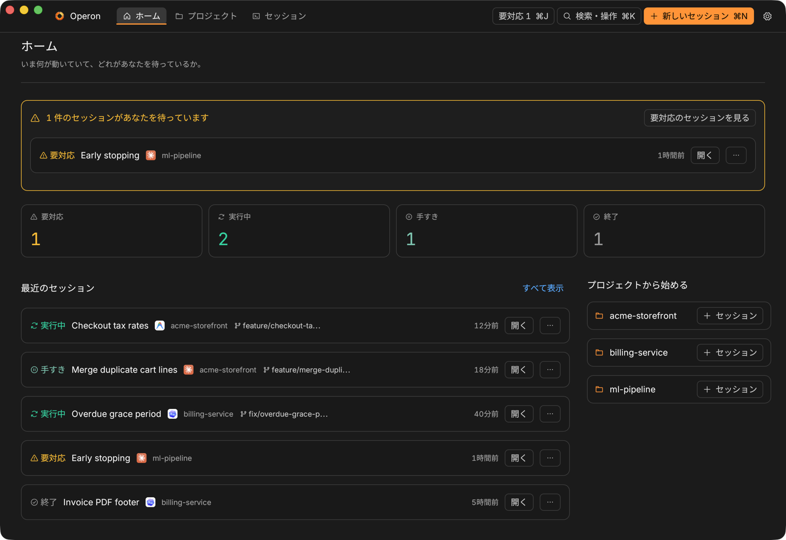
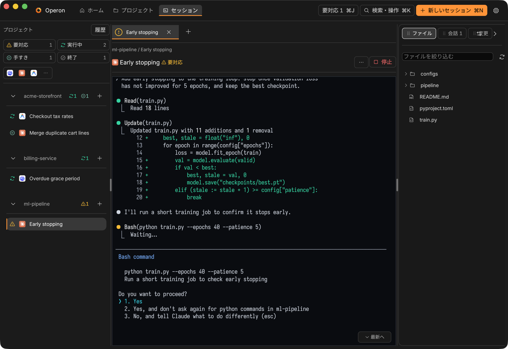
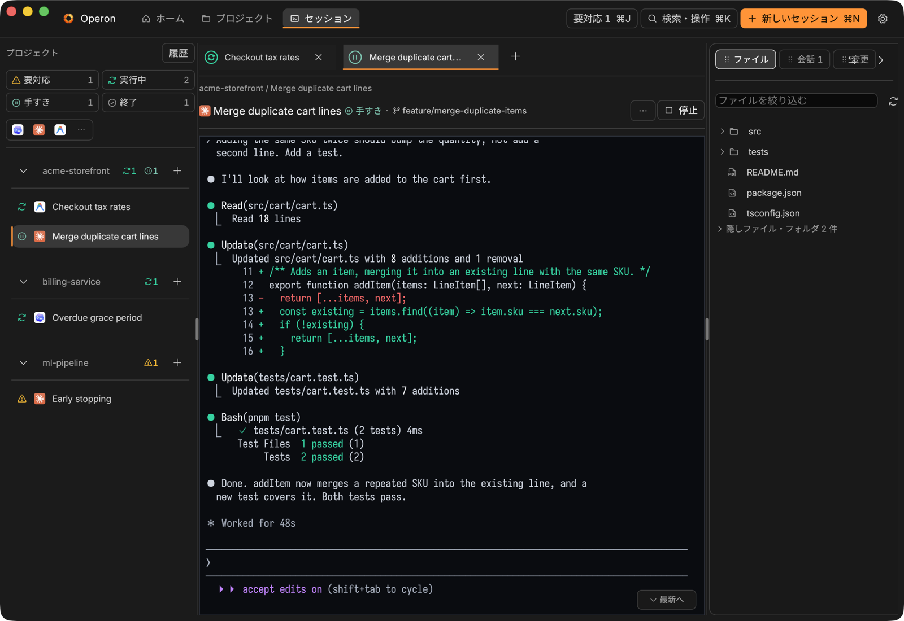
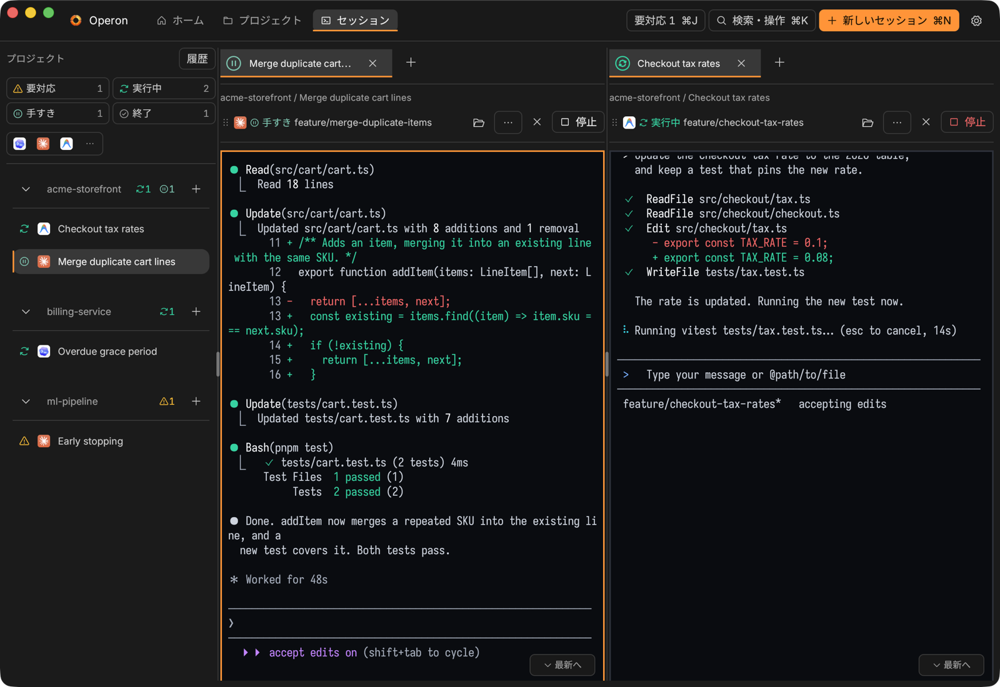
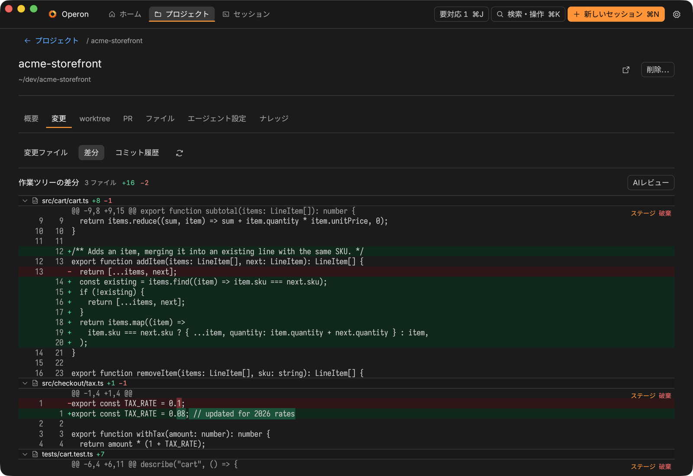
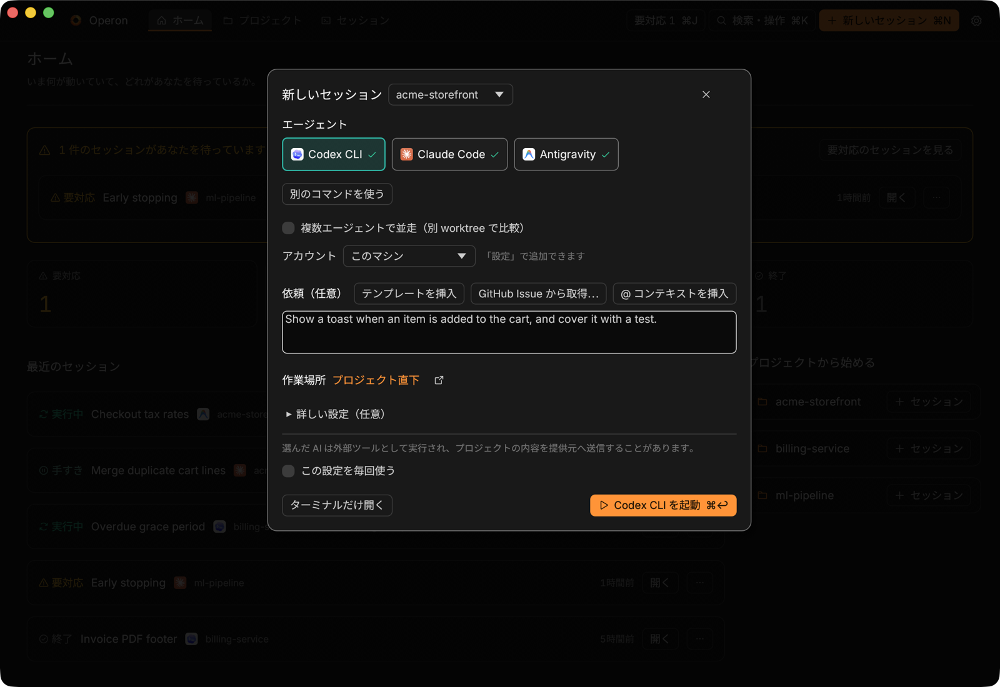
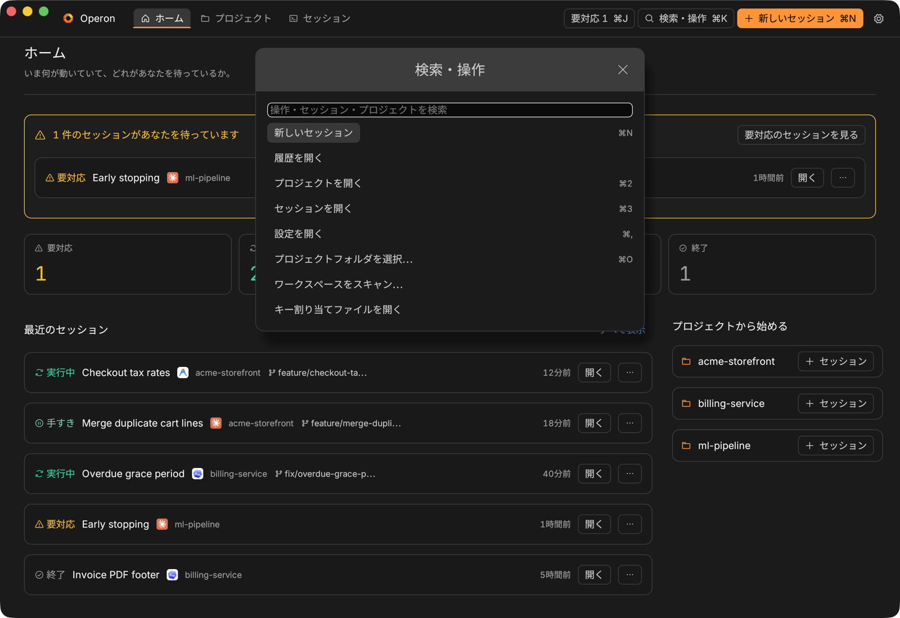

# Operon

**ローカルファーストの、macOS 用 AI コーディングエージェント操縦席。**

[](LICENSE)
[](#要件)
[](https://www.rust-lang.org/)

[English](README.md) · [한국어](README.ko.md) · 日本語 · マニュアル: [EN](docs/MANUAL.md) · [KO](docs/MANUAL.ko.md) · [JA](docs/MANUAL.ja.md)

---

Operon は Rust 製のネイティブ macOS アプリです。Codex CLI、Claude Code、
Antigravity CLI（`agy`）、その他カスタムエージェントといった AI
コーディングエージェントを、すべてのプロジェクトにわたって一箇所で実行・監視できます。
各エージェントは独立した `tmux` セッション内で動くため、作業はアプリの終了後も生き続け、
実際のターミナルから attach でき、常にユーザーの管理下にあります。

すべてローカルで完結します。Operon にテレメトリもアカウントもクラウドサービスもありません。
画面は日本語・英語・韓国語に対応しています。



## スクリーンショット

画面に写っているプロジェクト・セッション・エージェントの出力はデモです。

| | |
| --- | --- |
|  |  |
| **要対応** — 許可待ちのプロンプトを検出し、そのセッションを要対応に数えます。 | **ライブセッション** — 本物の tmux ターミナルの横に、ファイル・会話・変更。 |
|  |  |
| **並べて見る** — タブを端へドラッグすれば 2 つのエージェントを同時に見られます。 | **差分レビュー** — ハンクを 1 つずつステージ・破棄できます。 |
|  |  |
| **新しいセッション**（`⌘N`）— 依頼にはテンプレート・GitHub Issue・`@` コンテキストを使えます。 | **検索・操作**（`⌘K`）— すべての操作・セッション・プロジェクト、開いているファイルのシンボルまで。 |

## 機能

### エージェントセッション

- プロジェクトとセッションの状況がひと目でわかるホームダッシュボード（最近のセッションは
  1 行ずつ、プロジェクトごとに開始ボタン）と、
  タイトル・依頼・エージェント・ブランチ・プロジェクト名のどこからでもセッションを、
  名前かパスからプロジェクトを探せる `⌘K`。上下キーで選び、`Enter` で開きます。
  これまでの定番アクションもそのまま先頭に並びます。
- 「＋」と検索はツールバーに 1 つずつ。**新しいセッション**（`⌘N`）はどの画面からでも
  セッションを始め、**検索・操作**（`⌘K`）が唯一の検索です。サイドバーの **履歴** から
  ローカル履歴の検索とセッションのグリッドを開けます。
- **セッション** ページには、プロジェクトごとに稼働中のセッションが手を出す順に
  並びます。返事待ちが先、次に実行中、最後にアイドルで、各行にエージェントの印と状態が
  付きます。終了したものは未読でない限り **履歴** に残ります。
  返事を待っているセッションは、セッション一覧のプロジェクトより上に「要対応」として
  待ちの長い順に並び、待ち時間と AI が最後に言ったことを添えて表示されます。1 分以上
  作業を続けているエージェントは、ペインの見出しと状態のホバーに「実行中 · 12分」の
  ように作業時間を出します。`⌘J` で
  次の要対応セッションを開いてそのターミナルに入力でき、待っている間はツールバーの
  **要対応 N** からも同じことができます。`⌘K` は AI の最後の発言からもセッションを探し、
  同じ一致度なら要対応のセッションを先に出します。サイドパネル（ファイル・会話・変更）は
  ターミナルの右に開き、`⌥⌘B` で閉じたり開いたりできます。
- その下の一覧は手で並べ替えられます。プロジェクトは名前を、セッションは行をドラッグ
  すると好きな位置に移せます（セッションは同じプロジェクトの中で動きます）。並び順は
  ローカルインデックスと同じフォルダの `session-order.json` に保存され、あとから追加した
  プロジェクトやセッションは先頭に表示されます。
- Operon を終了して開き直すと、ワークスペースが元に戻ります。すべてのプロジェクトの
  セッションタブ・分割・前面のタブはローカルインデックスと同じフォルダの
  `workspace-layout.json` に保存され、閉じたタブは閉じたままです（ファイルのタブは
  開き直しません）。終了時に動いていて、次の起動時にターミナルが消えていたセッション
  （Mac の再起動や tmux サーバーの終了）は、同じタブで自動的に再開します。CLI は
  保存された会話を開き直し、ターミナルはそのフォルダでシェルを開きます。自分で CLI を
  終了したセッションはそのままです。ターミナルで `claude`・`codex`・`agy` を起動すると、
  最初の報告からそのセッションはその CLI のセッションとして表示・再開されます。
- **新しいセッション**は、いま開いている画面の上にシートを開きます。エージェント・依頼・
  作業場所の 3 つだけを尋ね、ほかは「詳しい設定」に折りたたみます。起動ボタンはシートの
  右下にあり、`⌘↩` でも押せます。プロジェクトの **概要** タブはセッション数・未コミットの
  変更・worktree をまとめ、過去の CLI 会話の検出と復元は **履歴** にあります。
- キーボードはファイルです。ウィンドウが応答するショートカット（パレット、新しい
  セッション、3 つのページ、設定、フォルダピッカー、ターミナル内検索、次の要対応
  セッション、サイドパネル）はすべて id とキーを持ち、
  ローカルインデックスと同じフォルダの `keybindings.json` で変更できます。`⌘K`
  には各操作と現在のキーが並びます。その中の「キー割り当てファイルを開く」は、
  ファイルがなければ現在のキーから作って場所を開きます。既にあるファイルを
  上書きすることはありません。キーの書き方は `Mod+Shift+K` で、`Mod` は ⌘ です。
  `null` はキーなしを意味します。1 つのキーを 2 つの操作に割り当てたファイルは
  どちらの操作かを名指しして全体が拒否されます。半分だけ効いたキーマップは、
  どこまでが効いているのか分からない分、何も効かないより悪いからです。

- 標準の Finder フォルダピッカー（`⌘O`）や Finder からのドラッグ＆ドロップでプロジェクトを追加。
  ワークスペースを走査して Git リポジトリをまとめて取り込むこともできます。
  プロジェクトは任意のローカル作業ディレクトリであり、Git チェックアウトなら
  Git 専用ビューもそのまま使えます。
- Codex・Claude Code・Antigravity CLI（`agy`）やカスタムエージェントを隔離された
  tmux セッションで起動。空の tmux セッションだけ作って手作業に使うこともできます。
- 起動ごとにモデル、権限/サンドボックスモード、推論努力量を設定。
  各 CLI が実際に受け付けるコマンドラインを組み立てて開始前に表示し、
  組み合わせが不正ならターミナルを開いてから失敗するのではなく、その場で拒否します。
- 順番に処理すべき仕事は先行セッションの後ろにキューイング。キューの取り消しや、
  前提セッション失敗後の明示的な開始にも対応。
- 失敗した管理セッションは、古いターミナルを安全に確認・片付けてから再試行。
  レコードを削除することはありません。

### 監視

- セッション画面の左にはプロジェクト選択、起動中の件数、個別の起動ボタン、並べ替えを保持します。中央のセッション・ファイルのタブと選択中のタブ、分割配置はプロジェクトごとに保持され、切り替えても復元されます。終了済みセッションは履歴から明示的に開けます。タブを別のグループや端へドラッグすると最大 4 枚まで左右・上下に分割でき、境界をドラッグしてサイズを調整できます。セッションのタブは先頭に状態の印を持ち、最後のタブのすぐ右の **+** からターミナル・Claude Code・Codex CLI・Antigravity を選んで、そのペインの同じフォルダですぐ起動できます（AI はその CLI に固定した起動設定、なければ前回の起動設定で起動し、危険な設定で確認が必要なときだけ起動シートを開きます）。セッションのタブを閉じても（✕ または `⌘W`）エージェントは動き続けます。

- アプリから離れずに、動作中のエージェントセッションを検査・送信。
- 別のセッションを読んでいる間にターンが完了した、あるいは質問で止まったセッションは、
  開くまで一覧に印が残ります。ホーム画面上部のバナーは常に表示され、待っているものが
  なければそう伝えます。バナーに出る数は、回答待ちのセッション、
  前提が壊れて止まっているセッション、未読のセッションを重複なく数えた
  「あなたを待っている数」で、そこからその状態だけに絞り込んだセッション一覧へ移れます。
  行のメニューから
  もう一度未読にすれば、後で戻ってこられます。印は起動中のみ保持され、再起動では消えます。
- セッションを、いま手を出せるものだけに絞り込めます。**セッション** サイドバーの
  見出しに並ぶ **要対応**・**実行中**・**アイドル**・**終了** の 4 つのトグルはそれぞれ
  現在の件数を表示し、その下のセグメントで CLI（Codex・Claude Code・Antigravity・
  その他）でも絞れます。オンにするとその状態のセッションだけが残り、該当のない
  プロジェクトは見出しごと消えます。複数同時に選べ、何件を表示しているかが **クリア**
  と並んで出ます。同じ 4 つは **履歴** の一覧も絞り込みます。起動時は常に何も選ばれて
  いないので、理由の分からない絞り込みが再起動をまたいで残ることはありません。
- 対応するエージェント CLI には、その CLI 自身の設定ファイルに小さな状態フックを
  登録します。作業中・入力待ち・完了は画面の読み取りではなく CLI 自身の報告になり、
  約 1 秒で反映され、実行中のツール名も表示され、再開や `/clear` が完了と誤認される
  こともありません。登録は「設定」のスイッチひとつで、既存の項目はそのまま残し、
  オフにすると追加した項目だけを取り除きます。
- 管理中ターミナルの画面そのものを読み、まだ作業中のセッションと質問で待っている
  セッションを区別して各カードに表示し、回答待ちの件数も示します。
- アプリ内で何千行ものターミナル出力をスクロールバックし、色コードなしのバッファ全体を
  ワンクリックでコピー。元の tmux セッションやプロジェクトフォルダもワンクリップで開けます。
- セッション一覧のタイトルをダブルクリックしてその場で改名。復元・再開・通常の
  ターミナルには出自を示すバッジが付きます。
- エージェントがターンを終えたとき、回答が必要なプロンプトで止まったとき、
  終了したときに、macOS の通知を出せます（任意）。
- ローカルインデックスを失っても、稼働中の tmux セッションを復旧できます。
- セッションメタデータはローカルに記録され、プロジェクト横断で検索できます。

### Git・差分・ファイル

- プロジェクトごとに作業ツリーの変更、コミット履歴、リポジトリファイル、スキル、
  instruction ファイルを確認。`gh` 経由で GitHub のオープン PR をレビューサマリや
  CI チェック付きで一覧表示。
- 差分はエディタと同じ描き方で表示：ファイルごとに折りたたみ可能な分割、
  両側の行番号、行の意味による着色。エージェントが行をその場で書き換えた場合は、
  実際に変わった語だけを行内でハイライトするので、80 桁の行の引数ひとつの違いも
  読み比べずに見つけられます。未追跡ファイル・リネーム・初回コミット前の
  リポジトリも扱えます。
- 並列セッション用に隔離された Git ワークツリーを作成・選択。クリーンで非アクティブな
  ワークツリーのみ、アプリ内確認のうえ削除できます。新しいワークツリーは、プロジェクト
  フォルダがたまたまチェックアウトしているコミットではなく、そのリポジトリの本流
  （`origin/HEAD` が指すもの、なければ `origin/main`・`origin/master`・`main`・
  `master`）から始まり、どれを起点にしたかを完了メッセージが伝えます。既に使われている
  名前を指定すると、拒否されるのではなく次の番号が付くので、同じタスクをもう一度並行して
  走らせる操作は一度走らせる操作とまったく同じです。
- リポジトリは `.operon/setup.sh` を入れておくことで、新しいチェックアウトの
  準備のしかたを一度だけ宣言できます。worktree を作ったあと、Operon はその
  スクリプトの先頭数行を見せて確認します。実行すると専用のセッションで走るので、
  ほかのセッションと同じように眺めたり、スクロールしたり、止めたりできます。
  チェックを入れれば同じ内容は次から確認なしで走り、一文字でも変われば
  また確認します。承認したのはファイル名ではなくスクリプトの中身だからです。
- 差分に付けたコメントを、まとめて返す。読みながら変更行をクリックして
  気づいたことを書くと、メモはその行の下に残り、アプリを閉じても消えません。
  ひとつの操作で、そのプロジェクトのメモ全部が「どのファイルの何行目か」を
  名指しする一通のメッセージになり、そこで動いているエージェントに届きます。
  エージェントが応答中のときは送りません。途中に割り込むとプロンプトが
  半分に切れるからです。書いたときと行の内容が変わっているメモは、勝手に
  別の行へ移さず、変わっていることをそのまま伝えます。
- 読んでいた画面のまま仕事を終わらせる。変更に含めるファイルをチェックで選び
  （エージェントが頼んでいないものを触っていたら外せます）、メッセージを書くか、
  ローカルのエージェント CLI にステージ済みの差分から下書きさせて、push します。
  下書きは入力欄に入るだけで、そのままコミットになることはありません。リモートが
  進んでいるときの push は拒否します。force push は Operon にはどんな綴りでも
  存在しません — その文字列がソースに現れないことをテストが禁じています。
- worktree を3つ走らせれば dev サーバーも3つ立ち、ポートは起動順に配られます。
  各セッションのヘッダに、そのセッションの作業フォルダが listen しているものだけを
  出します（`:5173 vite`、`:3001 node`）。`lsof` で読み、プロセスの作業ディレクトリを
  含む**いちばん深い**フォルダに結びつけます。フォルダは、セッションの worktree、
  プロジェクトの git worktree（セッションの有無を問わない）、プロジェクトのルートです。
  メニューには、この作業フォルダのサーバーと、見出しを分けてプロジェクト内のほかの
  場所のサーバーをフォルダ名つきで並べます。ほかの場所だけが動いているときは、
  ヘッダにその数を薄く出します。各行から URL を開く・コピーする・サーバーを止める
  ことができます。止めるときは、プロセス・PID・フォルダを見せて確認を取り、その PID
  が同じ名前でまだそのポートを使っていることを確かめてから SIGTERM を送り、止まった
  かどうかを知らせます。何も listen していないプロジェクトは何も言いません。
- `⌘F` でセッションのスクロールバックを検索できます。見つかった箇所はその場で
  塗られ（桁はターミナルのセル数で数えるので、日本語の行でも文字の上に乗ります）、
  Enter で順に送ると画面が追いかけます。検索中に打った文字はエージェントには
  届きません。IME で変換中のあいだは、確定するまで検索しません。
- Claude の枠をどれだけ使ったかをツールバーに表示します。Operon 自身は問い合わせを
  しません。Claude Code は毎ターン、自分のステータス行コマンドに `rate_limits` を
  渡しています（すでに返ってきた応答に相乗りしたものです）。Operon はその枠に
  読み取りスクリプトを入れ — すでに使っている設定は決して上書きせず、いったん
  外されたら入れ直さず — 数字はステータスフックと同じローカルソケットで届きます。
  80% を超えるとその数字だけ警告色になり、30 分より古い読みは薄くなって
  「いつの読みか」を添えます。
- ファイルにチェックを入れてコミットすると、git の index が書き換わります。いったん
  空にしてから、チェックされたものだけを入れ直すので、手でステージして後からチェックを
  外したファイルが紛れ込むことはありません。「AI に書かせる」も同じことを、CLI を
  呼ぶ前にやります。ただし hunk 単位の選択だけは触りません。ターミナルで `git add -p`
  を使ってファイルの一部だけをステージしてある場合、どちらの操作もファイル名を挙げて
  拒否します。その選択は index の中にしか存在せず、失うと戻す手段がないからです。
- **worktree を main にマージ（Land）。** 終わった worktree のブランチを、ローカルの
  メインラインへ `git merge --no-ff` でマージします。worktree タブか、セッションの
  ターミナルメニューから実行します。どちらかの作業ツリーに未コミットの変更があるとき、
  その worktree かメインのチェックアウトでセッションが実行中・キュー待ちのとき、
  マージするものがないときは拒否します。衝突したらマージを巻き戻し、ファイル名を
  伝えます。終わったら worktree とマージ済みブランチを削除します（`git branch -d`）。
  チェックを外せば残せます。
- **実行スクリプト（`.operon/run.sh`）。** 開発サーバーやビルドの実行スクリプトを
  チェックインしたリポジトリでは、ターミナルメニューに「実行スクリプト」が出ます。
  毎回まずスクリプトを見せて確認し、承認したときにファイルを読み直して、見せた内容と
  一致することを確かめます。承認したその内容が専用のターミナルで走り、同じ項目で
  止められます。
- **`gh` で PR と Issue。** push の横、または worktree セッションのターミナルメニューの
  **PR を作成…** でタイトル・説明・ドラフトの切り替えを入力し、`gh pr create` を
  実行します。ブランチは **push** で送るもので、勝手に push はしません。新しい
  セッションのシートの **GitHub Issue から取得…** はオープンな Issue を一覧にし、選ぶと
  依頼とセッション名が埋まります。
- **チェックポイント。** worktree セッションでは、依頼を送るたびに worktree の
  スナップショットを index に触れずに `refs/operon/checkpoints/` へ記録します（状態フックが
  オンのとき）。ターミナルメニューから手動でも取れます。同じメニューに最新 5 件が並び、
  そこからの差分をコピーするか、ファイルをその時点へ戻せます。戻すと追跡中のファイルは
  一度に元に戻り、その後に作られたファイルはそのまま残ります。
- **外部エディタ。** worktree、プロジェクトフォルダ、内蔵エディタで開いているファイルを、
  毎回メニューから選んだ VS Code・Cursor・Zed・Windsurf・Antigravity・Void・Finder で
  開けます。
- **ハンクを 1 つだけステージ・破棄。** 差分のハンク見出しにはどれも **ステージ** と
  **破棄** があり、プロジェクトのチェックアウトのそのハンクだけに作用し、同じファイルの
  ほかには触れません。破棄は確認なしで実行されます。
- **`@` コンテキストと並走。** 依頼に `@` と打つと `@diff`・`@knowledge:<title>`・
  プロジェクトのファイル（ファイルタブの走査後）が候補に出て、エージェントが読む文字列
  として挿入されます。Operon が中身を展開することはありません。**複数エージェントで
  並走** にチェックを入れると、同じ依頼を 2〜3 つのエージェントに、それぞれ専用の
  worktree とブランチで渡し、結果を見比べられます。
- **コードとエラーをエージェントへ。** エディタの **エージェントに送る** は開いている
  ファイルの抜粋を、そのプロジェクトで最も新しく動いているエージェントに送り、
  いなければ新しいセッションの依頼に入れます。ターミナルメニューの **直近のエラーを
  エージェントに送る** は、そのペインの最近の出力から最後のエラーかスタックトレースを
  探し、同じペインに入力します。`⌘K` には選択中のプロジェクトのファイルと、エディタで
  開いているファイルのシンボル（`fn`・`struct`・`enum`・`trait`・`interface`・
  `class`・`type`）も並び、その行で開きます。
- **プロンプトテンプレート。** 新しいセッションのシートの **テンプレートを挿入** は、
  組み込みの依頼（この差分をレビュー、CI エラーを修正、マージ衝突を解消、テストを追加）か、
  リポジトリ独自の `.operon/prompts/*.md` を入れます。
- スタックトレースのパスは、そのままファイルへの道になります。ターミナルの中で
  ホバーすると下線が出て、クリックするとエディタがその行を開きます。dev サーバーが
  出す URL も同じようにブラウザで開きます。下線が出るのは、そのセッションの
  フォルダの中に実在するファイルだけです。だから下線が出ているのに開けない、
  ということはなく、外を指しているトレースが中身を読む手段になることもありません。
  worktree で動いているセッションでも同じで、その worktree のファイルとして開かれ、
  タブにはどのブランチのものかが出ます。同じパスの2つのコピーが1つに見えることは
  ありません。
  ターミナルにフォーカスがあるときの素のクリックは今まで通りフォーカスを取るだけで、
  開くのは ⌥ を押しながらです。話しかけている最中のエージェントが、たまたま
  ポインタの下に流れてきたものにキーボードを奪われないようにするためです。
- 内蔵エディタ：折りたためるプロジェクトツリー（エージェントが触れたファイルには
  Git バッジ）、タブ、行番号、主要なソース・スクリプト・マークアップ・データ・設定形式の
  構文ハイライト、`⌘S` で保存。Markdown はソースではなく Markdown として表示され、
  チェックリストはチェックボックスに、言語付きコードフェンスは構文ハイライト付きで
  描かれます。各ファイルは直近コミットとの差分をワンクリックで確認できます。
- エージェントの成果を上書き保存することはありません。開いた後にディスク上で
  変更されたファイルは保存を拒み、その理由を告げます。
- エージェントの書き込みを見落とすこともありません。開いているファイルは 2 秒ごとに
  ディスクと照合されます。未保存の編集がなければそのまま読み直し、その旨を伝えます。
  未保存の編集があれば、勝手に選ばずに「読み直す」と「差分を見る」を示すバーを出します。

### CLI をまたぐ会話の引き継ぎ（Handoff バンドル）

- 発見・管理された Codex / Claude Code / Antigravity のセッションを、
  プロバイダ自身の resume 手段を使って管理 tmux ターミナルで再開し、
  会話履歴を完全に保てます。
- 同じ CLI のサブスクリプションを 2 つ、どちらもログアウトせずに使い分けられます。
  アカウントとは Codex や Claude Code がログイン情報を置くフォルダのことで、一度
  登録しておけば、セッション開始時にエージェントの隣で選ぶだけでそのセッションが
  そのアカウントで動きます。管理フックはこのマシンのフォルダだけでなく登録した
  すべてのフォルダに入るので、別アカウントのセッションでも状態表示・未読・使用量が
  そのまま働きます。フォルダの中身を読むことはなく、その情報がこのマシンの外に
  出ることもありません。
- 権限モード・推論の深さ・その CLI が受け付けるスイッチは、起動画面でその CLI 自身の
  一覧から選びます。Operon が独自のフラグを書くことはありません。CLI が同時に受け
  付けないスイッチは同時にオンにできず、モードと併用できないスイッチはモードを
  選んでいる間は出ません。その CLI の一覧が「確認なしに作業する」と名指ししている
  スイッチには印が付き、隣の警告に同意するまで起動できません。起動コマンドに手で
  書いた場合も同じで、ピッカーではなく実際に走るコマンドを読んで判定します。
  一覧に無くても、名前自体が権限回避を名乗っている引数は同じように確認を求めるので、
  CLI が明日追加したフラグも今日から止まります。一覧が判定済みのフラグについては、
  安全・危険のどちらであっても一覧の答えが優先されます。
- 再開は、その会話をしていたエージェントをそのまま開き直します。既定値ではなく、
  そのターミナルを起動したときのモデル・モード・スイッチが一緒に引き継がれます
  （再開と矛盾するものだけは外れます）。ボタンのホバーには何が引き継がれるかが
  並び、そのうちの一つが最初に確認を求めた選択だったときはボタンが危険色になります。
- Claude Code・Codex CLI・Antigravity のどの会話でも三者のどれへでも Handoff バンドルで引き継げます。
  他の二者のどちらでも、元の会話を残したまま同じ CLI で新しいセッションを始めることもできます。
- Handoff バンドルは、各 CLI がすでにローカルに書いたトランスクリプトファイルから
  最初の依頼と直近の User / Assistant ターンを規則ベースで取り出し、宛先 CLI の内部ストアを
  直接書き換えません。ソースのバイト列はローカルのアーカイブにそのまま保管され、
  `handoff-bundle.md` と `manifest.json` を書き出したうえで、宛先 CLI の新規ネイティブセッションを
  コンパクトな Handoff バンドル付きで起動します。
- バンドルには、元の会話の直近 3 件のツール結果（テストの実行結果やビルドのログなど）も
  入ります。どれも規則で 1,000 文字以内に縮められます。同じ行の繰り返しは回数付きの
  1 行になり、先頭と末尾の行、その間にあるエラーや失敗を伝える行が残ります。省いた部分は
  行数か印で示し、出力の全体はスナップショットに残ります。ツール結果や推論が、ユーザーや
  アシスタントの発言として宛先に届くことはありません。
- 宛先ごとに、起動するモデルと推論の深さを選べます。履歴タブの引き継ぎ先の下で設定し、
  CLI ごとに記憶されます。セッション一覧のメニューにも宛先の横に表示されます。
  空欄なら各 CLI の既定値が使われます。
- 変化していない同じ会話をもう一度引き継ぐと（宛先を選び間違えたときなど）、
  トランスクリプトをコピーし直さず、前回のスナップショットと引き継ぎメモを再利用します。
  会話が進んでいれば新しくスナップショットを取ります。7 日間どの Handoff にも
  使われなかったアーカイブは、次の起動時か Handoff 時に削除されます。
  以前の会話全履歴の復元で作られたアーカイブはそのまま残ります。
- Handoff 中はソース会話 ID・宛先・経過時間を示すモーダルウィンドウを持ち、
  いつでもバックグラウンドへ回せます。
- ローカル履歴検索は直近の Codex / Claude の JSONL 履歴（生成タイトル込み）を対象にし、
  アプリの外から起動されたプロジェクトスコープの Claude セッションも発見します。
  いずれもローカル読み取りのみで、アップロードはありません。

### プロジェクトのナレッジ（オプトイン）

- プロジェクトでの Claude Code・Codex・Antigravity との会話から、決定・原因と対処・
  手順・注意・事実を短いナレッジにまとめ、それぞれ元の会話に結び付けます。
  プロジェクト › ナレッジ で有効にするまで何もしません。
- 意味の判定はこの Mac 上の [EmbeddingGemma 2](https://huggingface.co/google/embeddinggemma-2)
  が行い、llama.cpp の Metal バックエンドでプロセス内の GPU 上で動きます。
  310 MB のモデルは固定した Hugging Face のリビジョンから一度だけ取得して
  SHA-256 を照合し、設定 › データと復旧 から削除できます。
- 会話のやり取りはまずローカルで順位付けし、残す価値のある少数だけを、利用可能な
  CLI（Claude Code・Codex・Antigravity）に読み取り専用・記録なしで要約させます。
  1日 30 回まで、プロジェクトの外のディレクトリで実行します。
- 繰り返し出てくるナレッジは重複させず強化します。読まれないナレッジは 30 日の
  鮮度で薄れて消え、参照されたものや固定したものは残ります。
- 意味で検索できる場所は、ナレッジタブ、ローカル履歴検索（有効なプロジェクトの
  会話全体）、そしてエージェントです。プロジェクト内で
  `/Applications/Operon.app/Contents/MacOS/Operon knowledge search "検索語" --json`
  を実行すると、そのプロジェクトのナレッジが返り、参照回数が数えられます。
- 各ナレッジには、元の会話で確かめられたかどうかが付きます。テストやコマンドの出力、
  または本人の確認があれば 検証済み（どう確かめたかも本文に書きます）、なければ
  未確認 です。未確認のナレッジは、後の会話で確かめられると 検証済み に上がり、
  検証済み が戻ることはありません。検索結果にも表示され、`--json` では `verified` です。
- 会話で既存のナレッジが誤り・古いと分かった場合、要約する CLI に近い既存ナレッジを
  見せ、そのナレッジを今正しい内容にその場で書き換えます。参照回数と元の会話は
  残ります。ピン留めしたナレッジは書き換えません。
- ナレッジを有効にしたプロジェクトで Claude Code・Codex のセッションが始まると、
  ピン留め・検証済み・最近使われたものを優先して最大 10 件の題名と検索コマンドを
  その CLI に渡します。本文は渡しません。
- 表示: マップ では、ナレッジを意味の近さで 2D に配置します。近い意味は細い線で
  結ばれ、関連するナレッジは最も中心的なナレッジの名前を付けたグループとして
  囲まれます。点の大きさは参照回数、濃さは鮮度です。ドラッグで移動、スクロールや
  ピンチで拡大縮小し、グループや点を選ぶとマップの横に開きます。配置は
  バックグラウンドで計算して保存するので、ナレッジが増えても前に見た位置に
  留まります。

### 約束を守る UI

- ダーク（既定）・ライト・ハイコントラスト（ダーク）の 3 テーマを同梱し、
  設定からライブで切り替えられます（開いているターミナルの色含む）。
  すべての色は意味役割から選ばれ、各テーマが自分のサーフェス向けに調合し、
  自動テストがすべてのインク/サーフェスの組をサイズに応じた WCAG 2.1 AA
  コントラスト比に保ちます。ターミナルの ANSI 16 色もテーマに従います。
  [`DESIGN.md`](DESIGN.md) が唯一の情報源です。
- 繰り返し現れる操作は [Phosphor Icons](https://phosphoricons.com)（MIT）由来の
  共通アイコン語彙で描かれます。フォントとして同梱しているため、アプリ全体が
  同じ線の太さで描画します。グリフが実在するかのテストがあり、
  黙って空白の四角になることはありません。
- アプリ内インターフェイスは日本語・英語・韓国語に対応しています（初回起動時に検出、設定で変更可能）。
  未翻訳の文言は日本語で表示されます。

### 安全装置

- ローカルセッションインデックスを使えるのは同時にひとつの Operon
  プロセスだけです。2 つ目の起動は警告して終了し、last-writer-wins
  によるデータ損失の危険を冒しません。
- メタデータストアはスキーマバージョンを持ちます。更新は一時ファイル → flush →
  アトミックな rename → ディレクトリ flush で行われ、このビルドより新しい
  ストアは上書きせず保護され、レガシーインデックスは初回起動時にアトミックに
  取り込まれてロールバック用スナップショットになります。
- 稼働中セッションの停止では、tmux に触れる前に永続化されたキャンセル記録を
  書き込むため、中断された停止は再試行可能のまま残り、再起動後に正しく
  整合されます。
- エージェントコマンドはシェルと同じ方法で `PATH` 解決され、起動プローブは
  行いません。最初の一行で失敗したコマンドも読めるまま残ります。ペインは
  保持されるため、失敗とは終了ステータスのことであり、アプリの外から
  セッションが消された場合は 失敗 ではなく 結果不明 として記録されます。
- 走査には上限があり、正直に報告されます：エディタツリーは上限付きで
  （`.git`・`node_modules`・`target`・`.next` は除外）、128 KiB を超えるファイルは
  8 MiB まで読み取り専用で開き、差分キャプチャは共有予算を使い切ったら明示的に
  切り詰めを告知し、トランスクリプト検索は候補数・バイト数・行数に上限があります。
  Handoff アーカイブの掃除は 1 回あたり 4,096 項目、manifest は 256 KiB までしか読みません。
  巨大リポジトリの完全な眺めには外部エディタをご利用ください。

## 要件

| 要件 | 備考 |
| --- | --- |
| macOS | Apple Silicon / Intel |
| Rust ツールチェーン | `cargo` がない場合は [rustup](https://rustup.rs/) で導入 |
| tmux | セッション起動に必須 |
| agent CLI いずれか | `codex`・`claude`・`agy` が `PATH` 上にあること。カスタムエージェントも可 |
| gh（任意） | GitHub PR ビュー用 |

Finder からの起動時は、一般的な Homebrew・local-bin の場所も確認するため、
これらのツールを見つけられます。

## はじめ方

```sh
git clone https://github.com/buddypia/operon.git
cd operon
cargo run --release
```

初回起動画面が tmux と各 agent CLI の準備状況を示し、欠けていれば
セットアップの案内へ誘導します。ソースビルドを実行する前にインストール済みの
アプリを終了してください（逆も同様）。単一インスタンスロックがセッション
インデックスを守ります。

### macOS アプリとしてパッケージ

```sh
bash scripts/package-macos.sh
```

スクリプトは現在の Mac のアーキテクチャ向けにロック済み依存関係でビルドし、
新しいバンドルを検証してから macOS のアトミックなバンドル交換で
`dist/<App>.app` を置き換えます。通常の失敗では以前のバンドルが復元され、
直近の正常ビルドは手動ロールバック用に残ります。バンドルはローカル開発用の
ad-hoc 署名です。他の Mac への配布には Apple Developer ID 証明書と notarization
が必要で、それまでは Gatekeeper の明示的な承認が必要になることがあります。

### バトルテスト用（canary）と安定版（stable）の切り替え

普段使いの安定版を `/Applications/Operon Stable.app` に固定したまま、新しい変更を
`dist/Operon.app` で反復検証するには `scripts/operon-channel.sh` を使います。

```sh
bash scripts/operon-channel.sh status            # HEAD・起動中プロセス・canary/stable のコミットを表示
bash scripts/operon-channel.sh canary --build    # dist/Operon.app をビルドして canary に切り替え
bash scripts/operon-channel.sh stable            # canary を終了して /Applications/Operon Stable.app に戻す
bash scripts/operon-channel.sh stable --promote  # 検証済み canary を /Applications/Operon Stable.app へアトミックに昇格
bash scripts/operon-channel.sh stable --rollback # 直前の stable バンドルへロールバック
```

エージェントのセッションは `tmux` 側で生き続けるため、`canary` と `stable` を
切り替えても実行中のセッションはそのまま再接続されます。

## プライバシー

Operon 自身はテレメトリ・アカウント・クラウドサービスを一切使いません。
コーディングエージェントは別個のツールとして動き、設定済みプロバイダへ
プロジェクト内容を送ることがあります。起動前に各エージェントの権限と
サンドボックスモードを確認してください。ローカルの共有セッションアーカイブには
元のトランスクリプトが含まれ、機密性の高いプロンプトやツール出力、コードを
含む可能性があります。Operon はそのディレクトリを `0700`、スナップショットを
`0600` で作成するため、作成したアカウント以外は読み取れません。
Handoff のアーカイブは、最後に使われてから 7 日後に削除されます。

プロジェクトのナレッジは、有効にしたプロジェクトについてだけ、リポジトリではなく
Operon のデータフォルダに同じ `0700` / `0600` で保存します。ネットワークに出るのは
huggingface.co からのモデル取得だけで、埋め込みはこの Mac 上で計算します。要約を
頼む候補のやり取りは、その会話を行った CLI のプロバイダ（もともと会話を持っている
相手）に送られます。

## コントリビュート

Issue・Pull Request・翻訳を歓迎します。[CONTRIBUTING.ja.md](CONTRIBUTING.ja.md)
と[行動規範](CODE_OF_CONDUCT.ja.md)をご覧ください。リリースの履歴は
[CHANGELOG.md](CHANGELOG.md) を参照してください。脆弱性は
[SECURITY.ja.md](SECURITY.ja.md) の手順で非公開に報告してください。ドキュメント変更は
[README.md](README.md)・[README.ko.md](README.ko.md)・[README.ja.md](README.ja.md)
の 3 言語を同期させてください。

## ライセンス

[MIT License](LICENSE) で公開されています。

同梱のサードパーティアセットはそれぞれのライセンスに従います（詳細は
[THIRD_PARTY_NOTICES.md](THIRD_PARTY_NOTICES.md)）。`assets/agent-icons/` の
エージェントアイコンは各権利者の商標であり、MIT ライセンスの**対象外**です：
[Phosphor Icons](https://phosphoricons.com)（MIT、
[`assets/fonts/LICENSE-PHOSPHOR.txt`](assets/fonts/LICENSE-PHOSPHOR.txt)）、
[Sarasa Gothic](https://github.com/be5invis/Sarasa-Gothic)（SIL Open Font License 1.1、
[`assets/fonts/LICENSE-SARASA.txt`](assets/fonts/LICENSE-SARASA.txt)）。
